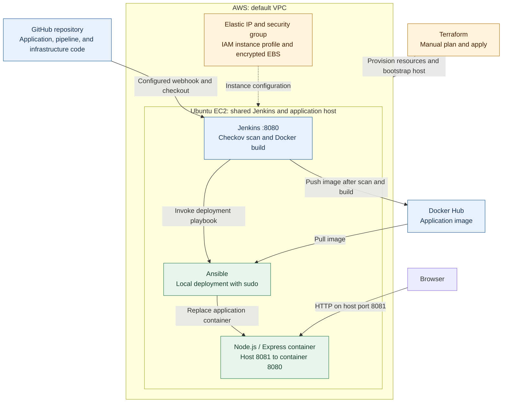
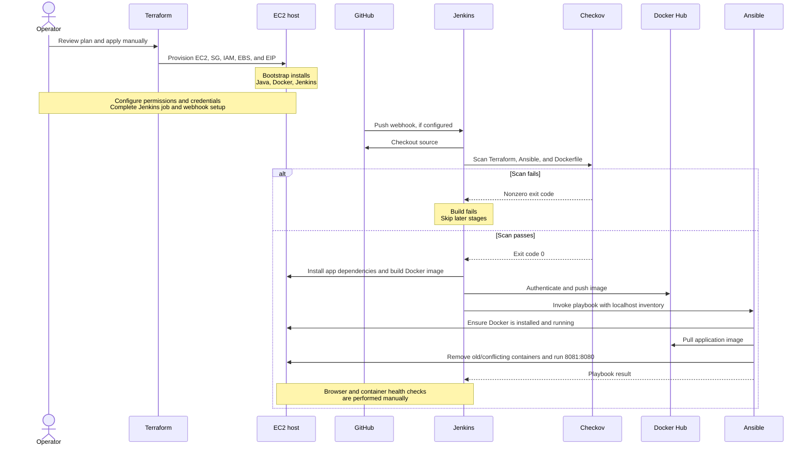

# CloudSentinel Architecture

CloudSentinel uses one Ubuntu EC2 instance for Jenkins and the application. Terraform is applied manually by an operator; each Jenkins run scans the repository, builds and publishes an image, then invokes Ansible locally on that host.

## System Architecture

Solid arrows show workflow or traffic. Dotted arrows show provisioning and infrastructure relationships. Checkov failing stops subsequent build and deployment stages.

## Deployment Sequence

## Implementation Notes

- Terraform is outside the Jenkins release pipeline. Its user-data script provides the initial Jenkins/Docker bootstrap; `configure-jenkins.yml` is a separate manual configuration option.
- Jenkins and Ansible deployment execute on the same Linux node. No SSH credential is used by the current pipeline; the old EC2 IP/user environment variables are unused.
- The security group currently defines SSH and Jenkins ingress only. Public application access needs an additional TCP `8081` rule.
- An Elastic IP makes the host public; disabling automatic public IP assignment does not make it private.
- The application listens on container port `8080`, and Docker publishes it as host port `8081`. Jenkins remains on host port `8080`.
- The playbook replaces containers using Docker CLI commands. It does not implement rollback, zero-downtime deployment, or an application-health gate.

## Suggested Report Caption

**Figure X.** CloudSentinel architecture showing manually provisioned AWS infrastructure and a Jenkins release pipeline that validates configuration with Checkov, publishes a Docker image, and deploys the application through local Ansible execution on the EC2 host.

For installation commands and implementation screenshots, see the [README](README.md).
