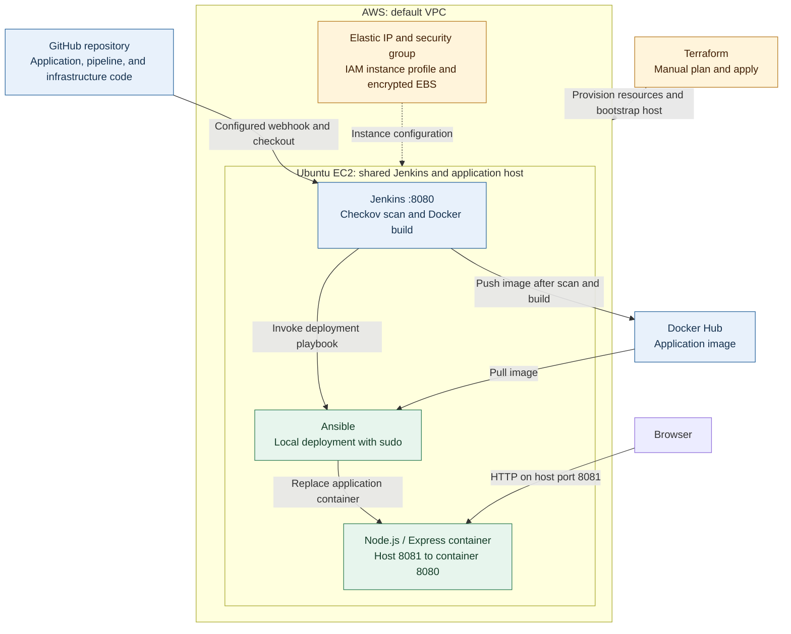
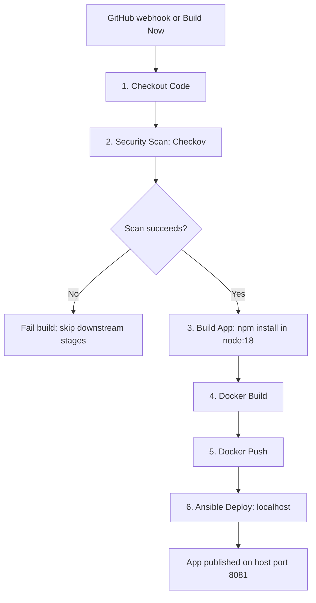
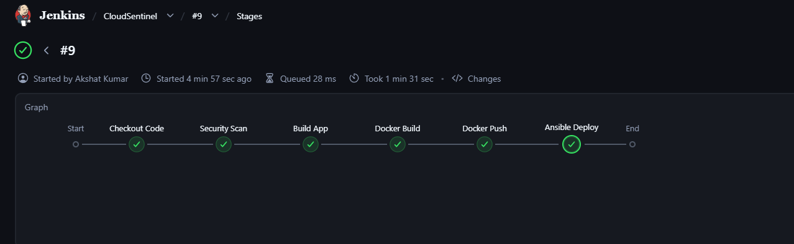
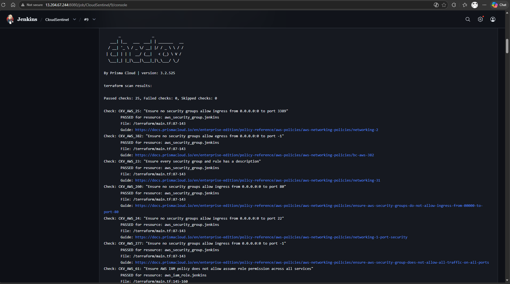
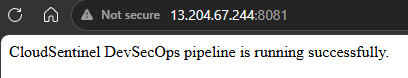
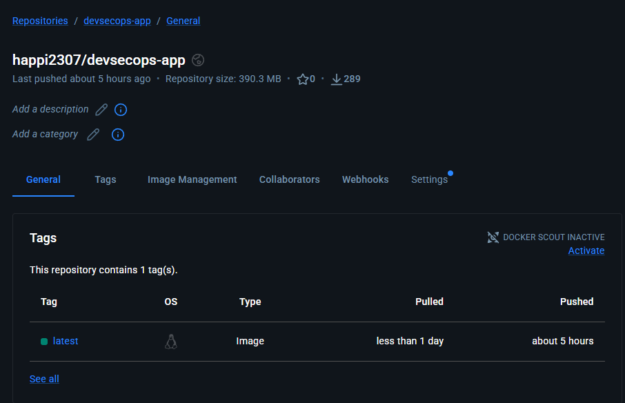

# CloudSentinel

### A DevSecOps pipeline from GitHub commit to application deployment on AWS.

CloudSentinel combines **Terraform, Jenkins, Checkov, Docker, and Ansible** to provision a cloud environment, check its configuration, and release a containerized Node.js application. It demonstrates how infrastructure code and application delivery fit together in a working deployment workflow.

**Terraform provisions the host manually. Jenkins scans, builds, and publishes the image. Ansible deploys it locally on the same EC2 instance.**

[Architecture](#architecture) | [Pipeline](#pipeline) | [Demo](#demo) | [Local Run](#run-locally) | [AWS Setup](#aws-setup) | [Troubleshooting](#troubleshooting)

## What It Demonstrates

- **Infrastructure as Code:** EC2, security groups, an IAM instance profile, encrypted EBS storage, and an Elastic IP defined in Terraform.
- **Security before release:** Checkov scans Terraform, Ansible playbooks, and the Dockerfile before subsequent pipeline stages run.
- **Container delivery:** Jenkins builds a Node.js image and publishes it to Docker Hub using stored credentials.
- **Deployment as code:** Ansible installs/starts Docker, pulls the application image, and replaces the running container.
- **Push-triggered builds:** GitHub webhooks can trigger Jenkins once configured in both services.

The web app is deliberately small: an Express service returning a status message at `/`. The focus of the project is the delivery workflow.

## Architecture



Terraform runs outside Jenkins; a GitHub push does **not** run `terraform apply`. Its user-data script bootstraps Java, Docker, and Jenkins. The separate configuration playbook can configure Jenkins manually; only `deploy-app.yml` runs during CI/CD.

| Component | Responsibility | Source |
|---|---|---|
| Terraform | AWS resource provisioning and host bootstrap | [Infrastructure](terraform/main.tf) |
| Jenkins | Checkout, scan, build, publish, and invoke deployment | [Pipeline](Jenkinsfile) |
| Checkov | Static configuration checks across the repository | `Security Scan` stage |
| Docker / Docker Hub | Package, store, and distribute the application image | [Dockerfile](Dockerfile) |
| Ansible | Host configuration and container replacement | [Playbooks](ansible/) |
| Node.js / Express | Serve the demonstration application's `/` route | [Application](app/index.js) |

See [Architecture Diagrams](ARCHITECTURE_DIAGRAM.md) for the deployment sequence and report-ready caption.

## Pipeline



| Stage | Current behavior |
|---|---|
| Checkout Code | Fetch the job's configured SCM revision using `checkout scm`. |
| Security Scan | Run `bridgecrew/checkov:latest -d /repo` against the mounted workspace. A nonzero exit stops the pipeline. |
| Build App | Install dependencies in a `node:18` container; Node/npm need not be installed on the host. |
| Docker Build | Build `happi2307/devsecops-app` with the repository Dockerfile. |
| Docker Push | Authenticate with `docker-creds` and publish the implicit `latest` tag. |
| Ansible Deploy | Generate a localhost inventory and run the deployment playbook with the image and host port as variables. |

Local deployment runs on whichever Jenkins node executes the job. Use the intended Linux EC2 host as the job's execution node; the leftover `EC2_IP` and `EC2_USER` variables do not select a remote deployment target.

## Demo

The following screenshots were extracted from the project report's implementation outputs. They document a previous demonstration; addresses and image tags shown are historical, not live demo endpoints.

**Jenkins pipeline:** all six stages completed in the captured run.



<details>
<summary>View security scan, deployed application, and registry screenshots</summary>

**Checkov:** the captured Terraform scan reports 25 passed checks and zero failed checks. Counts can change with scanner versions and configuration changes.



**Application:** a browser response from the app published on port `8081`.



**Registry:** the application image published to `happi2307/devsecops-app` on Docker Hub.



</details>

## Repository Layout

```text
CloudSentinel/
|-- app/                         # Express app, package manifest, and lockfile
|-- ansible/
|   |-- configure-jenkins.yml     # Manual controller configuration
|   |-- deploy-app.yml           # Application deployment tasks
|   |-- group_vars/all.yml       # Image, container name, ports, and packages
|   |-- inventory.ini.example    # Remote inventory example for manual use
|   `-- ansible.cfg
|-- terraform/main.tf            # AWS infrastructure and bootstrap script
|-- docs/images/                 # Implementation screenshots from the report
|-- Dockerfile
|-- Jenkinsfile
|-- ARCHITECTURE_DIAGRAM.md
`-- REPORT_*.md                  # Report draft, structure, and tables
```

## Run Locally

With Git and Docker installed, run these commands from your terminal:

```bash
git clone https://github.com/happi2307/CloudSentinel.git
cd CloudSentinel
docker build -t cloudsentinel:local .
docker run -d --name cloudsentinel-local -p 8081:8080 cloudsentinel:local
```

Open **http://localhost:8081/** to see the status message. The application listens on container port `8080`; `8081:8080` publishes it on host port `8081`.

Inspect or stop the local container:

```bash
docker logs cloudsentinel-local
docker inspect --format '{{.State.Health.Status}}' cloudsentinel-local
docker stop cloudsentinel-local
docker rm cloudsentinel-local
```

The image includes a health check and runs the app as the non-root `node` user. To run without Docker, use `npm install` and `npm start` inside `app/`, then open `http://localhost:8080/`. `npm test` currently checks JavaScript syntax only.

## AWS Setup

### 1. Prepare the Operator Machine

Install Terraform **1.5 or later**, Git, and an AWS authentication method supported by the AWS provider. Docker is needed if you run the same Checkov scan locally. Ansible commands run on Linux, macOS, or WSL; the Terraform commands below also work in PowerShell.

You need an AWS account with permission to manage the resources in [main.tf](terraform/main.tf), an existing EC2 key pair in the selected region, and a default VPC with a subnet routed to an internet gateway. AWS authentication belongs on the operator machine; the current Jenkins pipeline does not use AWS credentials.

Before provisioning, scan the repository from its root using the same command as CI, with a read-only mount:

```bash
docker run --rm -v "${PWD}:/repo:ro" bridgecrew/checkov:latest -d /repo
```

This is a manual prerequisite: Terraform itself does not invoke Checkov.

### 2. Provision Infrastructure with Terraform

Replace the example values with your AWS key pair name and trusted source CIDRs. Use `/32` for a single public IPv4 address.

```bash
cd terraform
terraform init
terraform validate
terraform plan -var "key_pair_name=YOUR_KEY_PAIR" -var "allowed_ssh_cidr=YOUR_IP/32" -var "allowed_jenkins_cidr=TEAM_CIDR"
terraform apply -var "key_pair_name=YOUR_KEY_PAIR" -var "allowed_ssh_cidr=YOUR_IP/32" -var "allowed_jenkins_cidr=TEAM_CIDR"
terraform output
```

Review the plan before confirming `apply`; it can create billable AWS resources. An existing manually created instance is not automatically adopted into Terraform state.

| Setting | Repository default |
|---|---|
| Region | `ap-south-1` |
| Instance | `t3.large` |
| Operating system | Canonical Ubuntu 24.04 AMD64 AMI |
| Root storage | 30 GiB encrypted `gp3` |
| Instance settings | IMDSv2 required, detailed monitoring, EBS optimization |
| IAM attachment | `AmazonSSMManagedInstanceCore` through an instance profile |
| Public access | Elastic IP associated with the instance |
| Terraform outputs | `jenkins_public_ip`, `jenkins_url` |

**Network setup:** the current security group defines ingress for SSH and Jenkins only. Add an inbound TCP `8081` rule for your intended app users in the EC2 console before testing public app access. That manual rule is outside the current Terraform definition. Override the placeholder SSH CIDR (`10.0.0.0/32`) and the default public Jenkins CIDR (`0.0.0.0/0`) for your environment.

### 3. Prepare the Jenkins Host

SSH to the Terraform output address using your private key. Keep the key outside the repository.

```bash
ssh -i /path/to/key.pem ubuntu@EC2_PUBLIC_IP
```

On the EC2 host, wait for bootstrap to finish, then install the tools not installed by user data:

```bash
sudo cloud-init status --wait
sudo apt-get update
sudo apt-get install -y git ansible openssh-client
sudo systemctl status docker jenkins --no-pager
sudo -u jenkins docker info
sudo -u jenkins ansible-playbook --version
sudo -u jenkins sudo -n true
```

The last check must succeed for unattended deployment: [deploy-app.yml](ansible/deploy-app.yml) uses `become: true`, including for fact gathering. An administrator must configure non-interactive sudo for the Jenkins account on this dedicated demo host. That privilege and Docker access give builds control over the host; use trusted jobs only.

Terraform already adds `jenkins` to the Docker group and restarts Jenkins. If you add group membership manually, restart the service so it takes effect. If bootstrap fails, inspect `sudo tail -n 100 /var/log/cloud-init-output.log`.

### 4. Configure the Jenkins Job

Open `http://EC2_PUBLIC_IP:8080/` and unlock Jenkins with:

```bash
sudo cat /var/lib/jenkins/secrets/initialAdminPassword
```

Complete the setup wizard, create an admin account, and install **Pipeline**, **Git**, **Credentials Binding**, and **GitHub** plugins. Docker Pipeline and SSH Agent are not required by the current Jenkinsfile.

Create a **Username with password** credential with ID **`docker-creds`**. Use your Docker Hub username and an access token with push access to the target repository. If you publish to your own namespace, update `DOCKER_IMAGE` in [Jenkinsfile](Jenkinsfile); update `docker_image` in [Ansible defaults](ansible/group_vars/all.yml) for manual deployments too. The local pipeline does not require `ec2-ssh`.

Create a **Pipeline** job with these values:

| Field | Value |
|---|---|
| Definition | Pipeline script from SCM |
| SCM | Git |
| Repository URL | `https://github.com/happi2307/CloudSentinel.git` |
| Branch | `*/main` |
| Script Path | `Jenkinsfile` |

Run **Build Now** once. Keep deployment runs serialized: the current pipeline replaces a shared container and uses a shared `latest` tag.

### 5. Enable Builds on GitHub Push

In the Jenkins job, enable **GitHub hook trigger for GITScm polling**. In the GitHub repository, add a webhook with:

| Field | Value |
|---|---|
| Payload URL | `http://EC2_PUBLIC_IP:8080/github-webhook/` for the demo, or your HTTPS Jenkins base URL plus `/github-webhook/` |
| Content type | `application/json` |
| Events | Just the push event |
| Active | Enabled |

GitHub must be able to reach the endpoint; a Jenkins rule limited to your team's IPs alone will block webhook deliveries. Configure ingress or a reverse proxy accordingly and check **Recent Deliveries** for a successful HTTP response. A webhook secret, if used, must be configured on the Jenkins side as well. See the [Jenkins GitHub plugin documentation](https://plugins.jenkins.io/github/) for trigger configuration.

### 6. Verify the Deployment

On the Jenkins EC2 host:

```bash
docker ps --filter name=cloudsentinel-app
docker logs --tail 50 cloudsentinel-app
docker inspect --format '{{.State.Health.Status}}' cloudsentinel-app
curl -f http://127.0.0.1:8081/
```

Allow time for the health check to move from `starting` to `healthy`. Then open `http://EC2_PUBLIC_IP:8081/` from your browser. If localhost works but public access does not, inspect the `8081` ingress rule and any host firewall.

## Ansible Outside Jenkins

The pipeline writes this ignored inventory automatically:

```ini
[app]
localhost ansible_connection=local
```

To run the same deployment manually on the EC2 host, clone the repository there and run:

```bash
cd CloudSentinel/ansible
printf '[app]\nlocalhost ansible_connection=local\n' > inventory.ini
ansible-playbook --syntax-check deploy-app.yml
ansible-playbook deploy-app.yml --ask-become-pass
```

`--ask-become-pass` prompts for the current user's sudo password; omit it when that account already has passwordless sudo. The playbook pulls the default public application image from Docker Hub.

For manual **remote** configuration, copy [inventory.ini.example](ansible/inventory.ini.example) to `inventory.ini`, replace its historical IP addresses and private-key paths, and use `ansible-playbook configure-jenkins.yml`. This optional playbook restarts Jenkins; run it outside active builds. The example uses SSH and is separate from Jenkins' localhost inventory.

## Security and Current Limits

- Checkov validates supported static configuration policies. It does not audit the running AWS environment or provide application vulnerability, penetration, or container-image vulnerability testing.
- The instance remains publicly reachable through its Elastic IP even though automatic public IP assignment is disabled. A passing scan is not evidence that the host is private.
- The project shares one host between the controller and application. Deployment removes the named app container **and any container publishing the app port**; reserve `8081` for this project.
- Deployment uses imperative Docker commands and always replaces the container. There is a service interruption, no rollback, and no health gate before Jenkins reports success.
- The Dockerfile and dependency stage use `node:18`, which is [end of life](https://nodejs.org/en/about/previous-releases). Upgrade both before production use. Scanner and application images also use mutable tags.
- `npm test` is a syntax check and is not called by the pipeline. Functional tests, HTTPS, separate build agents, image scanning, and monitoring remain future work.
- Private keys, Terraform state, and generated inventory are ignored. Keep AWS credentials and private keys out of Git, and protect Terraform state separately. There is no repository-level license file.

## Troubleshooting

| Symptom | Check |
|---|---|
| Waiting for next available executor | Confirm the execution node is online and has a free executor; inspect its disk monitor. |
| Node offline for low disk space | Run `df -h /var/lib/jenkins /tmp` and `docker system df`. The default root disk is 30 GiB; repeated image pulls/builds need free space. After resizing, refresh the monitor and bring the node online. |
| Jenkins service fails to start | Inspect `sudo journalctl -u jenkins -n 100 --no-pager` and available disk space. |
| `sudo: a password is required` | Check `sudo -u jenkins sudo -n true`; local Ansible needs non-interactive privilege escalation. |
| `ansible-playbook: not found` | Install Ansible on the Linux node executing the job. |
| Docker permission denied | Verify Jenkins' Docker group membership and restart Jenkins after changes. |
| Docker Hub push denied | Check `docker-creds` and write access to the namespace in `DOCKER_IMAGE`. |
| App unreachable | Test localhost, inspect container logs/health, and confirm the `8081:8080` mapping plus security group ingress. |
| Push does not trigger a build | Check GitHub Recent Deliveries, the webhook URL, network access, and the Jenkins job trigger. |

Avoid deleting Jenkins job history, credentials, Docker volumes, or all temporary files to resolve disk pressure. Inspect usage before cleanup.

## Project Documentation

- [Architecture and deployment sequence](ARCHITECTURE_DIAGRAM.md)
- [Project report draft](REPORT_DRAFT.md)
- [Report structure and screenshot placement](REPORT_STRUCTURE.md)
- [Report tables](REPORT_TABLES.md)

Useful official references: [Terraform AWS provider](https://registry.terraform.io/providers/hashicorp/aws/latest/docs), [Ansible local connection](https://docs.ansible.com/projects/ansible/latest/collections/ansible/builtin/local_connection.html), [Jenkins on Linux](https://www.jenkins.io/doc/book/installing/linux/), and [Checkov](https://www.checkov.io/).
